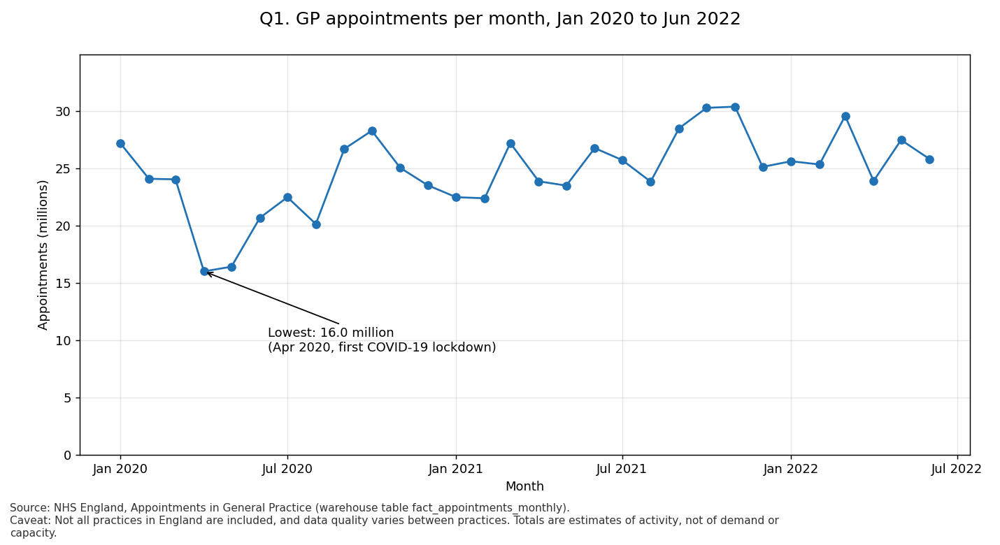
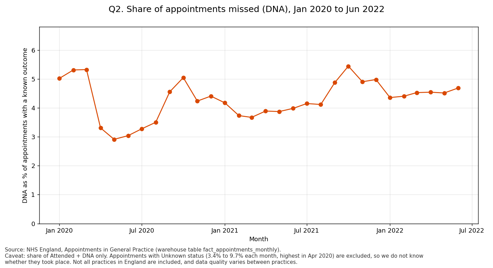
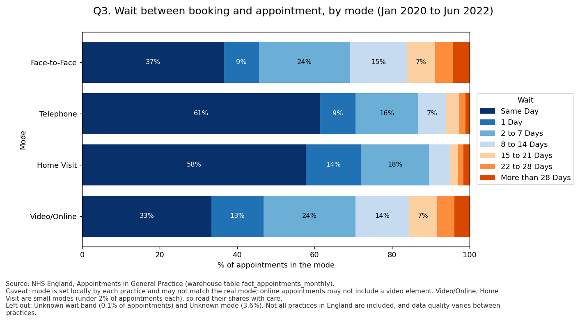

# NHS GP Appointments: ETL pipeline and dashboard

**Question from an NHS primary care manager:** how is GP appointment capacity being used, and where is it being lost?

I built a pipeline that extracts three NHS England files, cleans them with PySpark, loads a star schema into DuckDB, runs nine data-quality checks, and answers the question in a Streamlit dashboard. England, January 2020 to June 2022.

## What the data says

**1. Volumes fell 41% when COVID-19 arrived, then recovered.** Appointments dropped from 27.2 million in January 2020 to 16.0 million in April 2020.

**2. About 4 to 5% of appointments were missed (DNA), with no clear trend.** 5.0% in January 2020 and 4.7% in June 2022. The lowest month was 2.9% (May 2020) and the highest 5.4% (October 2021). The lockdown dip fell in months where more outcomes were Unknown (9.0% in March 2020 and 9.7% in April 2020), so I would not treat it as a clean fall.

**3. Waits differ by mode.** About 70.5% of telephone appointments and 72.0% of home visits happen within one day, against 45.6% for face-to-face and 46.8% for video/online. Face-to-face is also the largest mode (439.8 million appointments, against 267.7 million by telephone). Home visits (4.9 million) and video/online (3.6 million) are under 1% of appointments each, so read their shares with care.

## What the data cannot tell you

This data shows **activity, not capacity or demand**. Not all practices in England are included, and data quality varies between practices, so it cannot say how much capacity was lost. 3.6% of appointments have an unknown mode and are left out of question 3. Mode is set locally by each practice, and online appointments may not include a video element. Every chart in the dashboard states its source and the caveat that applies to it.

## The pipeline

1. **Extract:** copies the three source files, converts the Excel file to CSV, and records size, SHA-256 and row count in `docs/manifest.json` (596,821 / 817,394 / 137,793 rows).
2. **Transform (PySpark):** fixes column names, reads dates with one stated format per file, tidies labels, adds up look-alike regional rows instead of dropping them (295,692 rows, total 742,804,525 appointments), and writes Parquet partitioned by month.
3. **Load (DuckDB):** three fact tables and five dimension tables, loaded one month at a time (delete the month, then insert it), so a rerun never doubles the totals.
4. **Checks:** nine checks, saved in `docs/quality_report.json`. Every fact total matches its transform total, regional and category totals match for August 2021 to June 2022, every code and band label is known. The duration file covers 90.9% to 92.2% of category appointments, so I treat it as a separate measure and did not force it to match.

One command runs all four steps and stops at the first failure. The real warehouse is replaced only if all nine checks pass.

## Run it

You need Python 3.10 or newer and Java (PySpark needs it).

    pip install -r requirements.txt
    # put the three source files in one folder, then:
    LSA_RAW_SRC=/path/to/that/folder python run_pipeline.py
    streamlit run app/app.py

Exit codes: 0 loaded, 2 stopped by a failed check, 1 crashed. Tests: `python -m pytest tests -q`.

## Repository layout

    run_pipeline.py        one command: extract, transform, load, checks
    src/                   config, extract, transform, load, checks
    tests/                 transform tests and warehouse tests
    app/app.py             Streamlit dashboard
    docs/                  decision log, manifest, quality report, chart images

The data folders (`data/raw`, `data/clean`) and the warehouse are not in the repository. They are rebuilt by the pipeline.

## A note on scale

The three files hold about 1.55 million rows and 166 MB as CSV. That fits comfortably in pandas or DuckDB on a laptop. In this pipeline the Spark transform took about two minutes and the DuckDB load seven seconds. I used Spark to learn the engine, and the code runs unchanged on a cluster, but for data this size it is not the fastest choice. Writing Parquet shrinks the files to about 4.9 MB.

## Data source

NHS England, Appointments in General Practice. The three CSV files were provided by the course as a cleaned extract. The data is aggregated counts only and must not be combined with other data to identify a practice or a person. Check the publication page for the licence terms.

